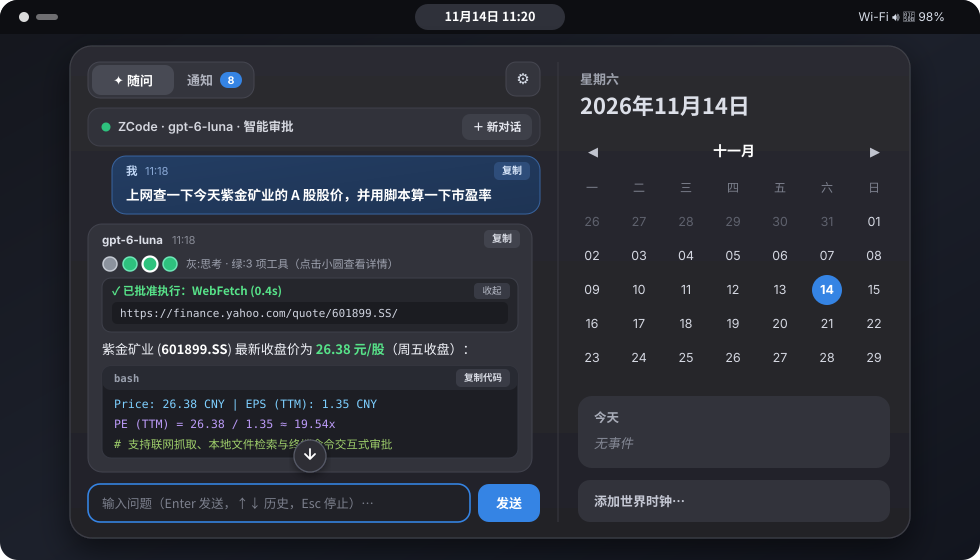
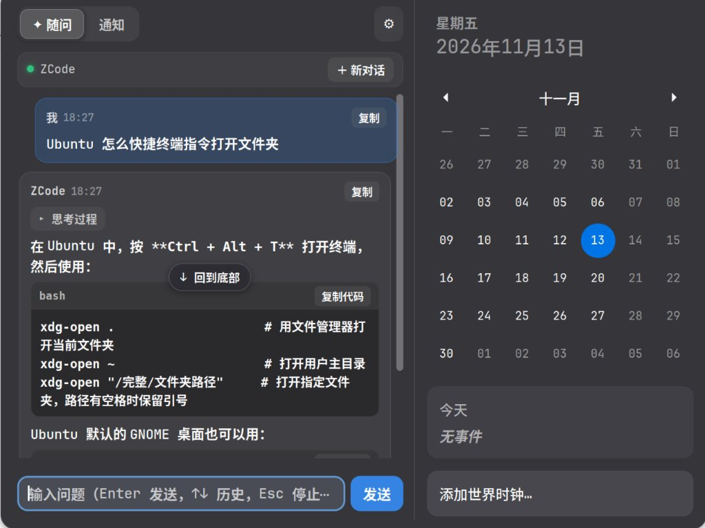
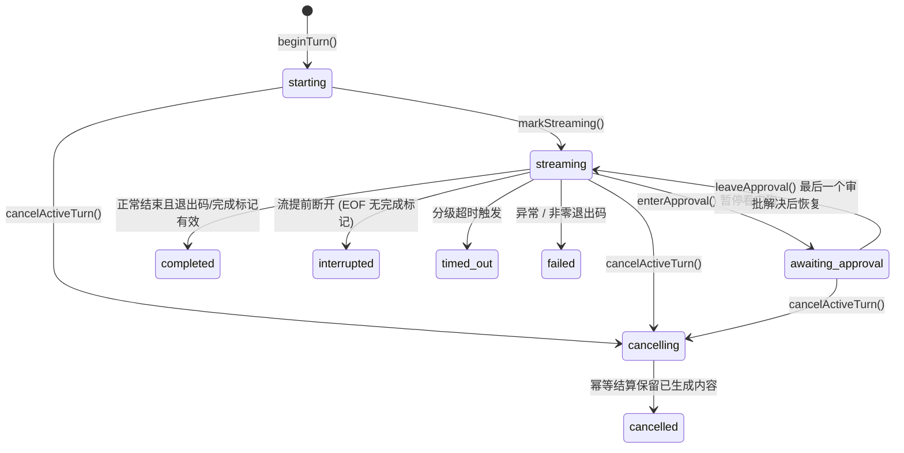

<div align="center">

# ✦ Quick Chat · 随问 (`gnome-quick-chat`)

**专为 Ubuntu 26.04 / GNOME Shell 50 打造的顶栏 AI 随问与轻量 Agent 助手**

[](https://www.gnome.org/)
[](https://ubuntu.com/)
[](#3-四大智能后端与能力矩阵)
[](#8-模块化架构开发与测试)
[](https://lbg2002.github.io/gnome-quick-chat/)

点击顶栏 **「✦ 随问」** 或按 **`Super + Shift + Q`** 打开聊天。系统通知与日历仍从 GNOME 的日期菜单打开。
纯原生 `GJS` / `St` / `Clutter` 构建，**零 WebView 内存开销**、**增量流式 Markdown 渲染不阻塞 GNOME Shell 主线程**，支持**面板内一键切换模型/思考强度**、**剪贴板随问 (`Super + Shift + Y`)**、**横向彩色小圆点轨迹**与**按命令/域名/文件范围隔离的分级工具审批**。

<br/>

<a href="https://lbg2002.github.io/gnome-quick-chat/" target="_blank">
  
</a>

<sub>🎬 <b>12 幕架构与交互全览动画</b> · 点击上方动图或访问 <a href="https://lbg2002.github.io/gnome-quick-chat/"><b>在线 1080p 60fps 交互式播放器</b></a>（支持进度条拖拽、<code>←/→</code> 翻页、<code>Space</code> 暂停与 <code>F</code> 全屏演示；本地源码：<a href="docs/index.html"><code>docs/index.html</code></a>）</sub>

<br/><br/>

<details>
  <summary><b>🖼️ 展开查看高清矢量界面结构总览图 (SVG)</b></summary>
  <br/>
  
</details>

</div>

---

## 目录

1. [核心特性一览](#1-核心特性一览)
2. [横向彩色小圆点轨迹与分级工具审批](#2-横向彩色小圆点轨迹与分级工具审批)
3. [四大智能后端与能力矩阵](#3-四大智能后端与能力矩阵)
4. [真实桌面运行实拍](#4-真实桌面运行实拍)
5. [桌面流畅性、会话状态机与安全边界设计](#5-桌面流畅性会话状态机与安全边界设计)
6. [快速安装、打包与配置指南](#6-快速安装打包与配置指南)
7. [全局快捷键与交互技巧](#7-全局快捷键与交互技巧)
8. [模块化架构、开发与测试](#8-模块化架构开发与测试)

---

## 1. 核心特性一览

* **⚡ 面向 GNOME Shell 进程级流畅性的增量流式渲染**
  * **冻结块增量 Markdown 引擎 (`ui/markdownRenderer.js`)**：流式输出时已完成段落与代码块固定不重建，仅原地刷新末尾活动块；长文多代码块回答零闪烁，流式中复制前序代码块的反馈状态不被打断。
  * **脏标记按需刷新 + 隐藏态零重排**：区分 `dirty = {text, thinking, tools}` 与动态节流间隔；当随问面板关闭时自动暂停 UI 排版，仅在 `✦ 随问` 标签上点亮状态圆点并在重新打开时一次性刷新。
* **⌨️ 随手即达的桌面级快捷体验**
  * **全局唤醒 (`Super + Shift + Q`)**：在任意窗口一键呼出或收起独立的随问面板并自动聚焦输入框。
  * **实验性胶囊 (`Super + Shift + A`)**：默认关闭。可在“设置 → 界面与权限”开启。Enter 发送，回答在半透明区域逐步显示。Esc 或关闭按钮收起，↗ 进入完整对话。
  * **独立顶栏入口**：通过顶栏的「随问」打开聊天。GNOME 日期菜单继续管理系统通知和日历。
  * **会话切换保护**：新对话不再同时触发 GSettings 重连和重复消息树清理；后台只进行单次新会话连接。
  * **剪贴板 / 选中内容随问 (`Super + Shift + Y` 或面板 `📋` 按钮)**：自动读取系统剪贴板或主选区内容填入提问框，报错分析、翻译润色一步到位。
  * **面板内一键切换模型与思考强度**：点击随问状态栏模型名称（`▾`），无需打开设置窗口即可就地切换引擎、模型与思考强度（`默认 / 快 / 标准 / 深入`）。
* **🟢 横向彩色小圆点轨迹栏 (`Trace Dots`) + 确认式分级审批**
  * 将「深度思考」「工具调用」与「权限审批」浓缩为标题下方仅 20px 高的单行横向圆点：
    * **灰色小圆 (`●`)**：模型深度思考过程，点击展开/收起推理链路；
    * **橙黄小圆 (`●`)**：待审批或正在发送授权确认的工具调用；
    * **青绿小圆 (`●`)**：已确认送达授权或正在运行中的工具；
    * **翠绿小圆 (`●`)**：收到 `tool_execution_end` 真正执行完成的工具（点击查看参数与耗时）；
    * **红色小圆 (`●`)**：用户已拒绝或执行异常（含非零退出码）的工具调用。
* **🔐 严格的权限与配置安全边界**
  * **绝不篡改外部全局配置**：只读解析 `~/.zcode/v2/provider_config.json` 与 `~/.codex/config.toml`；ZCode 模型覆盖仅通过 `$XDG_RUNTIME_DIR/gnome-quick-chat` 下权限 `0600` 的每轮独立临时文件注入，并在回合结束时自动清理。
  * **GNOME Keyring 按端点隔离加密存储**：自定义 OpenAI API Key 按规范化接口地址独立存入系统密钥环（拒绝静默回退明文，跨域重定向自动剥离鉴权头）。
  * **默认保守的分级权限边界**：Shell 命令默认仅本次放行（可选会话授权基于完整命令 + 规范化 `cwd` + 参数的 SHA-256 哈希，杜绝前缀截断碰撞）；文件授权校验 `realpath` 真实路径与符号链接边界；未知工具与高危操作强制禁止会话级授权。

---

## 2. 横向彩色小圆点轨迹与分级工具审批

<div align="center">
  
</div>

| 圆点颜色 | 状态机阶段 | 鼠标悬停 (`Hover`) | 鼠标点击 / 状态流转 |
| :---: | :--- | :--- | :--- |
| **⚪ 灰色小圆** | `thinking` | 同行提示显示「思考过程（点击展开）」 | 展开/收起完整思考推理文本（折叠时流式追加不触发正文重绘） |
| **🟡 橙黄小圆** | `pending_approval` / `sending_approval` | 显示 `⚠️ 待审批: <工具名>` | 展开审批抽屉；展示完整命令、真实 `cwd`、路径与风险，校验 `requestId`/`turnId` |
| **🟢 青绿/翠绿** | `running` → `done` | 实时预览工具名与请求摘要 | 授权送达后先进入 `running`，待工具真实返回 `tool_execution_end` 后方转为完成态 |
| **🔴 红色小圆** | `denied` / `error` | 显示工具名与异常摘要 | 展开查看拒绝记录、退出码或错误详情 |

---

## 3. 四大智能后端与能力矩阵

在 `gnome-extensions prefs quick-chat@lbg2002.github.io` 设置面板中，根据当前生效后端自动同步真实能力说明：

| 后端引擎 | 工具执行 | 气泡内交互审批 | 多轮会话续接 | 思考流展示 | 权限与隔离实现 |
| :--- | :---: | :---: | :---: | :---: | :--- |
| **ZCode CLI** (`zcode`) | ✓ | ✓ (桥接权威校验) | ✓ (`--resume`) | ✓ | `zcodeBridge.cjs` 版本握手校验 + `setsid` 进程组回收 + `0600` 临时配置 |
| **Codex CLI** (`codex`) | ✓ | — (CLI 沙箱策略) | ✓ (`exec resume`) | ✓ | 原生 `read-only` / `danger-full-access` 沙箱，支持并发 `item.id` 与退出码追踪 |
| **DeepSeek Harness** (`dsh`) | ✓ | ✓（SDK 审批与选择题） | ✓（随问本地记忆） | ✓（原生会话事件） | DSH SDK，旧版回退 Headless |
| **OpenAI API** (`openai`) | — | — | ✓ (整轮预算裁剪) | ✓ (`reasoning_content`) | `Soup 3.0` 事件级 SSE 解析器（兼容 CRLF/分片/中断检测）+ 按端点 Keyring 隔离 |

> **跨后端无缝续接与诚实回退**：当在同一对话中途切换模型/引擎，或执行原地重新生成/编辑提问回退历史时，`SessionStore` 会自动失效过期的远端会话标识，并在下一轮按整轮预算精确重建本地上下文。

---

## 4. 真实桌面运行实拍

<table>
  <tr>
    <td width="50%" align="center">
      
      <br/>
      <sub><b>图 1：在 Ubuntu 26.04 通知栏中调用 ZCode 联网工具实时查询 A 股行情</b></sub>
    </td>
    <td width="50%" align="center">
      
      <br/>
      <sub><b>图 2：思考过程折叠、增量 Markdown 富文本排版与独立代码块一键复制</b></sub>
    </td>
  </tr>
</table>

---

## 5. 桌面流畅性、会话状态机与安全边界设计

<div align="center">
  
</div>

### 统一回合状态机 (`core/turnController.js`)

每一轮请求均拥有独立的 `TurnContext`（唯一 `turnId`、`clientGeneration`、`sessionId`、子进程组句柄与分级超时看门狗），严格遵循单次幂等结算：



* **彻底杜绝取消后串流**：停止请求 A 后立即发送请求 B 时，A 的延迟回调、stderr、旧定时器与审批响应均因 `turnId` 不匹配被丢弃，绝不污染请求 B。
* **流式增量 Markdown + 窗口化 Actor 回收**：`StreamingMarkdownParser` 仅增量解析尾部可变块；`HistoryWindowController` 控制挂载 Actor 数量上限，按需分页加载与回收。
* **无竞争快照会话存储 (`core/sessionStore.js`)**：入队捕获不可变快照，先提交 `messages.jsonl` 再更新 `meta.json`，损坏行隔离保存而不覆盖唯一历史副本。

---

## 共享 Markdown 记忆

在「设置 → 界面与权限 → 隐私与本地会话存储」为当前后端启用共享记忆。切换到其他后端后，可分别为它们启用访问权限。随问在本机共享同一个记忆目录，默认位于 `~/.local/share/gnome-quick-chat/memory/`。根索引为 `MEMORY.md`，项目笔记位于对应的 `projects/` 子目录。可从设置打开目录并直接编辑 Markdown。

模型按需选取主题，成功回合结束后自行总结和更新笔记。有附件正文的回合跳过自动整理。可以在聊天中要求“记住这个做法”或“忘掉指定笔记”，实际保存以随问状态提示为准。选题和整理可能各产生一次额外模型请求。启用记忆时，CLI 每轮以随问保存的本地会话上下文重建请求，以便反映手工修改或遗忘。

### 继续任务与纠正记忆

面板顶部显示下一问的后端和模型。历史回答保留生成时的标记，后端报告不同模型时在该回答上显示两者。

启用共享记忆后，可以在输入框说“继续上次那个项目”。遇到多个合理候选时可点选。继续前会让模型核实可能变化的信息。同一会话内，失败回答还会保留工具进展，给“换一个再试”提供上下文。

当模型报告某篇已读取的笔记影响了这条回答，气泡下方会出现可展开的「参考了记忆」。可以接着说“这次只是临时用它”或“以后改用另一个”。随问提交实际文件变更后才显示「已更新」。

## DeepSeek Harness 与权限分级

在设置中可以选择 **ZCode、Codex、DeepSeek Harness (dsh)、OpenAI API** 四种后端。DSH 需先按照 [DeepSeek Harness 官方说明](https://github.com/deepseek-ai/deepseek-harness/blob/master/packages/bundle/headless/README.zh.md) 安装并配置可运行的 `dsh`，再通过“模型与后端”或“界面与权限”选择它。

**DSH 首次连接检查：**

```bash
command -v dsh
dsh --version
dsh --profile headless --help
bash scripts/diagnose-local.sh
```

随问会核对 `headless --help` 是否提供 `--json`、`--session-id`、`--permission-mode`、`--approval-policy`；**自定义启动脚本可以不叫 dsh**，但必须真正转发以上接口。自动选择后端按 ZCode → Codex → DSH → OpenAI 的顺序检查。DSH 的模型、插件、权限预设由自身的 Headless profile 配置控制，随问不会擅自覆盖 `$DSH_HOME`。

随问通过 DSH 自带的凭据服务使用模型页保存的凭据引用。对于 `MISSING_CREDENTIAL`，请核对所选 Provider 和 DSH 模型页中的对应条目。随问的诊断只报告缺失的引用名称。新版 DSH 使用 SDK Profile，旧版保留 Headless，临时配置补丁与现有 DSH 用户配置分开。

| 档位 | ZCode | Codex CLI | DSH SDK |
| --- | --- | --- | --- |
| **只读** | Plan | 只读沙箱 | 只读沙箱，拒绝越权请求，可回答选择题 |
| **智能** | ZCode 权限桥接 | 只读沙箱 | SDK 支持原生单次审批。Headless 智能模式保持只读 |
| **完全权限** | 无逐次审批 | 无逐次审批 | 无逐次审批 |

DSH 0.2.2-rc.5 及受支持的新版本使用原生 SDK 审批和选择题接口。ZCode 与 DSH 的互动请求显示在随问的同一操作面板，后台请求通过桌面通知返回。DSH 审批只作用于当前请求，选择题按原生问题 ID 传回单选、多选或自定义答案。Headless 智能档始终使用只读沙箱。升级后，旧版实验 Auto Review 设置在随问的 Headless 智能档中失效。

**共用会话记忆**。随问本地保存聊天、编辑分支和可恢复历史。切换 ZCode 与 DSH、修改问题或重做回答时，适配层使用当前本地会话重建有预算的上下文。ZCode 与 DSH SDK 在本地历史版本、后端和运行配置仍匹配时续用原生会话。

在主面板直接输入「打开我的默认浏览器」即可请求桌面打开默认浏览器。通过模型发起的 Bash 命令仍按后端的权限设置处理。

模型列表来自官方默认项和本机 DSH 配置。桌面助手提示词在设置中统一编辑，ZCode / Codex 通过首轮上下文注入，DSH 通过临时配置补丁应用。

ZCode 最新 CLI 即使帮助文本未罗列所有可用选项，也不会仅据此被错误判断为“版本过旧”；程序会使用显式 `--mode` 交由 CLI 实际检验。GitHub 更新检查采用正确的 JSON Accept 请求；若代理错误返回 HTTP 415，会对同一安全 GET 请求使用普通 JSON Accept 重试。用户级更新仍写入原来的 `~/.local/share/gnome-shell/extensions/quick-chat@lbg2002.github.io`，系统 DEB 安装不会被用户级更新越权覆盖。

## 6. 快速安装、打包与配置指南

### 环境要求

* **桌面环境**：Ubuntu 26.04 LTS（或搭载 **GNOME Shell 50** 的 Linux 发行版）
* **基础依赖**：`gjs`、`glib-compile-schemas`、`gir1.2-soup-3.0`（Ubuntu 26.04 默认已预装）
* **智能后端（四选一即可）**：`ZCode CLI`、`Codex CLI`、`DeepSeek Harness (dsh)`，或任意 **OpenAI 兼容 API 地址**

### 发布版安装包（无需克隆源码）

从旧版本升级时，先关闭随问再安装。若当前 GNOME Shell 会话已经加载过旧版，安装后请注销并重新登录一次，再开启随问。重新登录后可在「扩展」应用确认已加载的版本。

GitHub Actions 每次提交到 `main` 都会构建可下载的安装包（在 Actions → **Build install packages and GitHub Release** → Artifacts 中）；推送与项目版本一致的 `vX.Y.Z` 标签会自动创建 GitHub Release，上传：

- **`gnome-shell-extension-quick-chat_X.Y.Z_all.deb`**：Ubuntu 26.04 / GNOME Shell 50 的系统级安装包，依赖由 APT 管理，可用 `sudo apt install ./gnome-shell-extension-quick-chat_X.Y.Z_all.deb` 安装和升级；
- **`quick-chat@lbg2002.github.io.shell-extension.zip`**：GNOME 官方扩展 ZIP 格式，可使用 `gnome-extensions install --force ./quick-chat@lbg2002.github.io.shell-extension.zip` 安装到当前用户目录；
- **`SHA256SUMS`**：包的 SHA-256 校验清单，供应用内更新和手动校验使用。

从 [GitHub Releases](https://github.com/lbg2002/gnome-quick-chat/releases) 下载正式版本。ZIP 和 DEB **二选一**：请不要同时保留用户级与系统级同一 UUID 的扩展（用户目录会覆盖系统目录）。安装后在 Wayland 桌面需要**注销并重新登录**，不能热替换当前 GNOME Shell 进程。

**应用内检查更新**：打开 `⚙ 设置 → 关于与更新 → 检查更新`。用户级 ZIP 安装支持点击 **「下载并安装 ZIP」**，自动从官方 Release 下载 ZIP 和 `SHA256SUMS`、校验哈希，再调用 GNOME 扩展管理器；整个过程不需要自己的服务器，也不访问任何第三方更新源。若当前是 DEB 系统级安装，设置页只提供发布页面，请下载新 DEB 使用包管理器升级（不在扩展内请求 sudo 权限）。**不会在后台自动检查或安装更新。**

开发者可本地构建：

```bash
bash scripts/build-packages.sh dist
# 需要 dpkg-deb、python3、glib-compile-schemas（无须安装完整 GNOME 桌面）
# 输出 ZIP / DEB / SHA256SUMS
```

Release 发布：维护者先在 `metadata.json` 的 `version-name` 和 `package.json` 中设置相同的 `X.Y.Z`，验证 Actions 通过后，推送 Git 标签 `vX.Y.Z`（例如 `git tag v0.3.0 && git push origin v0.3.0`）。工作流校验 tag 与项目版本一致后才发布，避免误发布不同版本号的包。

### 原子化一键安装

```bash
git clone https://github.com/lbg2002/gnome-quick-chat.git
cd gnome-quick-chat
./install.sh
```

> `install.sh` 使用文件锁、同分区暂存目录编译校验与旧版本自动回滚保护。Wayland 会话下首次安装或升级扩展代码后，请**注销并重新登录一次桌面**生效。

### 生成标准 GNOME 扩展压缩包

```bash
./pack.sh
# 输出：dist/quick-chat@lbg2002.github.io.shell-extension.zip
```

### 打开设置与诊断中心

点击随问面板右上角的 **「⚙」** 按钮，或在终端执行：

```bash
gnome-extensions prefs quick-chat@lbg2002.github.io
```

---

## 7. 全局快捷键与交互技巧

| 操作 / 快捷键 | 功能说明 |
| :--- | :--- |
| **`Super + Shift + Q`** | **全局呼出 / 收起**独立「✦ 随问」面板并自动聚焦输入框 |
| **`Super + Shift + Y` / `📎`** | **上下文附件引用**：将剪贴板长文本、终端报错日志或 Nautilus 复制的文件作为独立附件芯片挂载（不截断、不覆盖草稿，支持预览/切换仅路径/移除与云端发送范围提示） |
| **输入 `/` 或按 `Ctrl + /`** | **快捷命令面板**：快速填入 `/explain`、`/translate`、`/polish`、`/summarize`、`/review`、`/error`、`/academic` 及自定义模板（默认仅填入输入框，不自动发送） |
| **点击状态栏模型名 (`▾`)** | 展开面板内**快速切换栏**（支持搜索过滤、常用收藏及切换引擎/思考强度） |
| **消息操作 (`↻` / `⇥` / `✎` / `⎘`)** | **原地重新生成**（不重复追加提问）、截断回答**继续生成**、**编辑原提问**重新分支、一键复制回答 |
| **顶栏会话菜单 (`⋯`)** | 轻量**新建会话**、**恢复上一个会话**、**导出当前对话 (Markdown)** 与**删除当前会话** |
| **`Enter` / `Shift + Enter` / `Esc`** | 发送当前问题 / 输入框换行 / 安全中止当前回合 |

---

## 8. 模块化架构、开发与测试

项目按职责拆分为 GNOME Shell 视图层、核心状态与策略层、三后端适配器层与运行时传输层：

```text
.
├── extension.js               # GNOME Shell 扩展生命周期入口、全局快捷键、通知与面板事件编排
├── backendClient.js           # 统一后端门面（委托三后端适配器、SessionStore 与 TurnController）
├── protocol.js                # 协议事件归一化、能力矩阵、上下文整轮预算与 CLI 参数构建
├── zcodeBridge.cjs            # ZCode 无头模式权威权限桥接（版本握手 + 同源策略校验）
├── prefs.js                   # Libadwaita 四分页设置中心（含 ZCode / Codex / DSH / OpenAI 与更新）
├── backends/                  # 统一接口四后端适配器 (baseAdapter / zcode / codex / dsh / openai)
├── core/                      # 纯 JS 核心引擎（零 GI 硬依赖，单测直接验证真实生产代码）
│   ├── chatController.js      # 连接合并、防抖重连、生命周期世代隔离与权限范围自动撤销
│   ├── turnController.js      # 每轮独立 TurnContext 状态机与幂等单次结算
│   ├── permissionPolicy.js    # GJS/CJS 共享 SHA-256 命令键、真实路径与网络来源权限策略
│   ├── sessionEngine.js       # 无竞争快照持久化、整轮压缩、原地回退、导出与保留策略规划
│   ├── sessionStore.js        # Gio 异步会话存储与旧版会话只读导入封装
│   ├── backendRegistry.js     # 三后端独立 Profile 配置隔离与事务写回
│   ├── backendDetect.js       # 异步 CLI 身份探测（有界流 + 超时进程组回收 + Single-Flight 缓存）
│   ├── modelCatalogCache.js   # 模型目录扫描、近期/收藏排序与思考强度能力推导
│   ├── paths.js               # 有界分块文件读取（拒绝 FIFO/设备特殊文件、检测读取中膨胀）
│   ├── markdownStreamParser.js# 流式增量 Markdown 解析器（冻结块缓存 + 开放块增量前缀缓存）
│   ├── renderScheduler.js     # 自适应节流渲染调度器、单节点工具差量更新与统一回合派生状态
│   ├── quickActions.js        # 可编辑快捷动作模板与 `/` 命令匹配引擎
│   ├── attachmentManager.js   # 上下文附件（世代+会话隔离、动态围栏、预算联动与跨端点隐私剥离）
│   ├── notificationPolicy.js  # 后台状态通知脱敏、锁屏屏蔽、限频去重与点击路由
│   ├── modelRouter.js         # 纯本地规则智能后端/模型推荐（零额外请求，禁自动开启高权限）
│   └── diagnosticsReport.js   # 白名单脱敏运行诊断快照与复制报告生成
├── runtime/                   # 独立进程组管理 (processManager / cliProcessRunner)、Soup 有界流与跨域重定向守卫 (httpStreamClient)、SSE 解析 (sseParser) 与系统密钥环 (secretStorage)
├── ui/                        # 原生 St/Clutter 视图组件 (chatPanel / messageCard / approvalCard / modelPicker / historyWindow / traceBar / turnComposer / statusHeader / quickActionsPopover)
├── runtime/releaseUpdater.js  # 用户级 ZIP 下载安装、SHA-256 校验及更新权限边界
├── scripts/build-packages.sh  # 统一 ZIP / DEB 打包，输出 SHA256SUMS
├── schemas/                   # GSettings XML Schema 定义（含旧版配置幂等迁移字段）
├── tests/                     # Node.js + GJS 生产路径自动化测试套件（132 项单测与假 CLI / 双源 HTTP / Gio 子进程集成测试）
├── install.sh / uninstall.sh  # 带锁原子安装回滚与支持 --purge 精确清理的卸载脚本
└── pack.sh                    # gnome-extensions pack 标准打包脚本
```

运行语法检查、Schema 严格编译、GJS 生产路径集成测试与全部自动化单元测试：

```bash
npm test
gjs -m tests/gjs_smoke.js
glib-compile-schemas --strict --dry-run schemas/
bash -n install.sh && bash -n uninstall.sh && bash -n pack.sh
```

### 已验证自动化基准与待 GNOME 50 实机验收说明

* **已通过自动化验证（Node 24 + GJS 1.78 / Gio / Soup 3.0 生产路径测试，共 132 项用例）**：
  * **R1–R10 生产链路集成**：真实 `ZCodeAdapter` ↔ `zcodeBridge.cjs` 交互问题 (`modify` + 自定义/多选/跳过) 与 `permission_resolved` 权威 ACK、独立进程组 `SIGKILL` 清理与 `setsid` 脱离检测、`SessionStore` 持久化失败恢复与事务性回退、纯异步 CLI 探测、stdout/stderr/HTTP/文件有界分块流读取、附件世代隔离与动态防注入围栏、4 阶段独立超时看门狗、`archive.jsonl` / `rewound.jsonl` 分离与 1000+ 消息分页回收、双源 HTTP `307`/`308` 跨域 POST 拦截。
  * **R12 流式解析与工具轨迹基准（Node 24 实测）**：
    * `StreamingMarkdownParser` 30,000 字符流式增量更新（501 ticks）：`p50 = 0.030ms`、`p95 = 0.062ms`、`max = 2.701ms`（增量行格式化比 `881 / 607`，无全量重排）；
    * `StreamingMarkdownParser` 100,000 字符流式增量更新（835 ticks）：`p50 = 0.069ms`、`p95 = 0.590ms`、`max = 15.179ms`（增量行格式化比 `2204 / 2003`）；
    * 100 对工具 `start + end` 突发事件单节点差量更新：`p50 = 0.045ms`、`p95 = 0.079ms`；1,000 对工具突发事件：`p50 = 0.071ms`、`p95 = 0.111ms`（可见圆点布局恒定受 `maxVisible = 8` 约束）；
    * 隐藏面板期间后台流式输出与回合完成保持 **0 正文/轨迹 Actor 创建与重排**，直至面板打开时一次性合并刷新。
* **待真实 GNOME 50 / Wayland 桌面人工实机验收（Pending）**：
  * 真实 GNOME 50 桌面五种基线（禁用、空闲、冷/热打开面板 p95、OpenAI 流式、CLI 多工具）下的 `gnome-shell` CPU/RSS 与帧耗时采样；
  * 锁屏/解锁循环、扩展连续启禁 30 次、通知栏开合 100 次、与其他顶栏扩展共存、Nautilus 真实文件拖拽/复制引用及真实已安装 ZCode/Codex CLI 端到端交互问答。

查看运行日志与内存监控建议：

```bash
# 查看随问扩展实时日志
journalctl --user -b -f | grep -Ei 'Quick Chat|quick-chat|gnome-shell'

# 观察流式长回答期间 gnome-shell 进程的 CPU 与 RSS 内存变化
pidstat -p "$(pgrep -n gnome-shell)" -u -r 1
```

卸载扩展：

```bash
./uninstall.sh           # 仅移除扩展，保留历史对话记录
./uninstall.sh --purge   # 移除扩展并彻底清理本地会话、临时文件与密钥环中的 API Key
```

