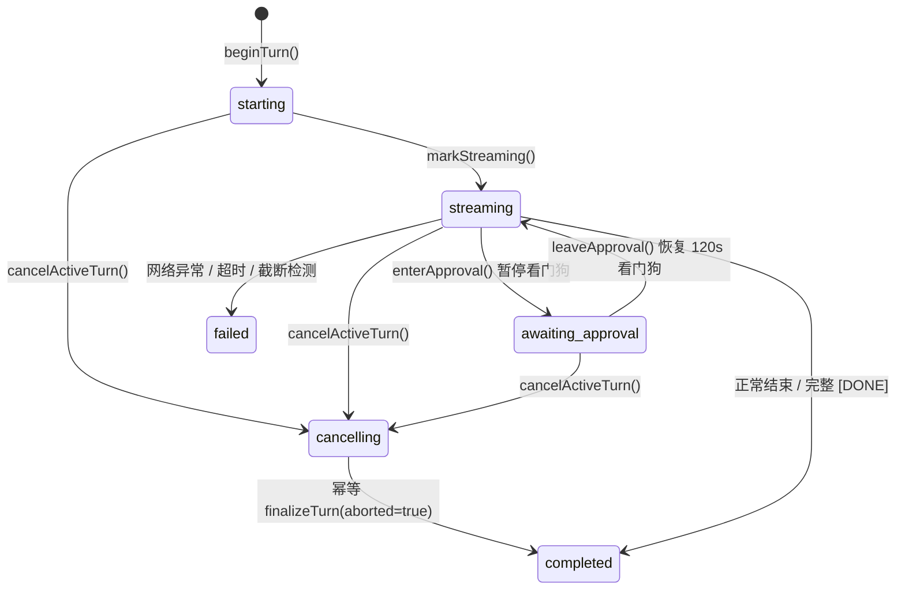

<div align="center">

# ✦ Quick Chat · 随问 (`gnome-quick-chat`)

**专为 Ubuntu 26.04 / GNOME Shell 50 打造的系统通知栏原生 AI 随问与轻量 Agent 助手**

[](https://www.gnome.org/)
[](https://ubuntu.com/)
[](#3-三大智能后端与能力矩阵)
[](#8-模块化架构开发与测试)
[](https://lbg2002.github.io/gnome-quick-chat/)

点击屏幕顶部中央的「时间 / 日期」（或按下全局快捷键 **`Super + Shift + Q`**），即可在通知栏左栏无缝切换 **「✦ 随问 | 通知」**，右侧原生日历与世界时钟保持原样。  
纯原生 `GJS` / `St` / `Clutter` 构建，**零 WebView 内存开销**、**增量流式 Markdown 渲染不阻塞 GNOME Shell 主线程**，支持**面板内一键切换模型/思考强度**、**剪贴板随问 (`Super + Shift + Y`)**、**横向彩色小圆点轨迹**与**按命令/域名/文件范围隔离的分级工具审批**。

<br/>

<a href="https://lbg2002.github.io/gnome-quick-chat/" target="_blank">
  
</a>

<sub>🎬 <b>12 幕架构与交互全览动画</b> · 点击上方动图或访问 <a href="https://lbg2002.github.io/gnome-quick-chat/"><b>在线 1080p 60fps 交互式播放器</b></a>（支持进度条拖拽、<code>←/→</code> 翻页、<code>Space</code> 暂停与 <code>F</code> 全屏演示；本地源码：<a href="docs/index.html"><code>docs/index.html</code></a>）</sub>

<br/><br/>

<details>
  <summary><b>🖼️ 展开查看高清矢量界面结构总览图 (SVG)</b></summary>
  <br/>
  
</details>

</div>

---

## 目录

1. [核心特性一览](#1-核心特性一览)
2. [横向彩色小圆点轨迹与分级工具审批](#2-横向彩色小圆点轨迹与分级工具审批)
3. [三大智能后端与能力矩阵](#3-三大智能后端与能力矩阵)
4. [真实桌面运行实拍](#4-真实桌面运行实拍)
5. [桌面流畅性、会话状态机与安全边界设计](#5-桌面流畅性会话状态机与安全边界设计)
6. [快速安装、打包与配置指南](#6-快速安装打包与配置指南)
7. [全局快捷键与交互技巧](#7-全局快捷键与交互技巧)
8. [模块化架构、开发与测试](#8-模块化架构开发与测试)

---

## 1. 核心特性一览

* **⚡ 面向 GNOME Shell 进程级流畅性的增量流式渲染**
  * **冻结块增量 Markdown 引擎 (`ui/markdownRenderer.js`)**：流式输出时已完成段落与代码块固定不重建，仅原地刷新末尾活动块；长文多代码块回答零闪烁，流式中复制前序代码块的反馈状态不被打断。
  * **脏标记按需刷新 + 隐藏态零重排**：区分 `dirty = {text, thinking, tools}` 与动态节流间隔；当通知栏关闭或处于「通知」标签时自动暂停 UI 排版，仅在 `✦ 随问` 标签上点亮状态圆点并在重新打开时一次性刷新。
* **⌨️ 随手即达的桌面级快捷体验**
  * **全局唤醒 (`Super + Shift + Q`)**：在任意窗口一键呼出或收起通知栏随问面板并自动聚焦输入框。
  * **剪贴板 / 选中内容随问 (`Super + Shift + Y` 或面板 `📋` 按钮)**：自动读取系统剪贴板或主选区内容填入提问框，报错分析、翻译润色一步到位。
  * **面板内一键切换模型与思考强度**：点击随问状态栏模型名称（`▾`），无需打开设置窗口即可就地切换引擎、模型与思考强度（`默认 / 快 / 标准 / 深入`）。
* **🟢 横向彩色小圆点轨迹栏 (`Trace Dots`) + 确认式分级审批**
  * 将「深度思考」「工具调用」与「权限审批」浓缩为标题下方仅 20px 高的单行横向圆点：
    * **灰色小圆 (`●`)**：模型深度思考过程，点击展开/收起推理链路；
    * **橙黄小圆 (`●`)**：待审批或正在发送授权确认的工具调用；
    * **青绿小圆 (`●`)**：已确认送达授权或正在运行中的工具；
    * **翠绿小圆 (`●`)**：收到 `tool_execution_end` 真正执行完成的工具（点击查看参数与耗时）；
    * **红色小圆 (`●`)**：用户已拒绝或执行异常（含非零退出码）的工具调用。
* **🔐 严格的权限与配置安全边界**
  * **绝不篡改外部全局配置**：只读解析 `~/.zcode/v2/provider_config.json` 与 `~/.codex/config.toml`；ZCode 模型覆盖仅通过 `$XDG_RUNTIME_DIR/gnome-quick-chat` 下权限 `0600` 的每轮独立临时文件注入，并在回合结束时自动清理。
  * **GNOME Keyring 密钥环加密存储**：自定义 OpenAI API Key 通过 `libsecret` (`gi://Secret`) 加密存入系统密钥环，自动迁移并清空旧版明文配置。
  * **细粒度会话授权规则**：会话级放行严格绑定到具体命令（`Bash:cmd:<cmd>`）、目标域名（`WebFetch:host:<host>`）或目标文件（`Edit:file:<path>`）；对 `rm -rf`、`sudo`、`dd`、`mkfs` 及 `/etc/` 写入等高危操作**强制禁用会话级一键放行**。

---

## 2. 横向彩色小圆点轨迹与分级工具审批

<div align="center">
  
</div>

| 圆点颜色 | 状态机阶段 | 鼠标悬停 (`Hover`) | 鼠标点击 / 状态流转 |
| :---: | :--- | :--- | :--- |
| **⚪ 灰色小圆** | `thinking` | 同行提示显示「思考过程（点击展开）」 | 展开/收起完整思考推理文本（折叠时流式追加不触发正文重绘） |
| **🟡 橙黄小圆** | `pending_approval` / `sending_approval` | 显示 `⚠️ 待审批: <工具名>` | 展开审批抽屉；点击后先进入 `sending_approval` 校验管道写回，若未送达则保留抽屉提示重试 |
| **🟢 青绿/翠绿** | `running` → `done` | 实时预览工具名与请求摘要 | 授权送达后先进入 `running`，待工具真实返回 `tool_execution_end` 后方转为完成态 |
| **🔴 红色小圆** | `denied` / `error` | 显示工具名与异常摘要 | 展开查看拒绝记录、退出码或错误详情 |

---

## 3. 三大智能后端与能力矩阵

在 `gnome-extensions prefs quick-chat@lbg2002.github.io` 设置面板中，根据当前生效后端自动同步真实能力说明：

| 后端引擎 | 工具执行 | 气泡内交互审批 | 多轮会话续接 | 思考流展示 | 权限与隔离实现 |
| :--- | :---: | :---: | :---: | :---: | :--- |
| **ZCode CLI** (`zcode`) | ✓ | ✓ (分级范围规则) | ✓ (`--resume`) | ✓ | `zcodeBridge.cjs` 握手校验 (`protocolVersion: 1`) + `0600` 临时配置沙箱 |
| **Codex CLI** (`codex`) | ✓ | — (CLI 沙箱策略) | ✓ (`exec resume`) | ✓ | 原生 `read-only` / `danger-full-access` 沙箱，支持并发 `item.id` 与退出码追踪 |
| **OpenAI API** (`openai`) | — | — | ✓ (字符预算裁剪) | ✓ (`reasoning_content`) | `Soup 3.0` 原生 SSE 流（含非正常中断检测）+ GNOME Keyring 密钥存储 |

> **跨后端无缝续接**：当在同一对话中途切换模型或 CLI 引擎时，`SessionStore` 会通过完整模型签名 (`backend + provider + model + baseUrl`) 自动识别变更，并在新后端首轮提问时按字符预算自动注入近期上下文摘要，避免误恢复旧引擎会话 ID。

---

## 4. 真实桌面运行实拍

<table>
  <tr>
    <td width="50%" align="center">
      
      <br/>
      <sub><b>图 1：在 Ubuntu 26.04 通知栏中调用 ZCode 联网工具实时查询 A 股行情</b></sub>
    </td>
    <td width="50%" align="center">
      
      <br/>
      <sub><b>图 2：思考过程折叠、增量 Markdown 富文本排版与独立代码块一键复制</b></sub>
    </td>
  </tr>
</table>

---

## 5. 桌面流畅性、会话状态机与安全边界设计

<div align="center">
  
</div>

### 统一回合状态机 (`core/turnController.js`)

每一轮请求均拥有独立的 `TurnContext`（独立 `turnId`、`Gio.Cancellable`、子进程句柄、临时文件列表与超时看门狗），严格遵循单次幂等结算：



* **彻底杜绝取消后串流**：停止请求 A 后立即发送请求 B 时，A 的延迟异步回调因 `isCurrent(turnA) === false` 被严格丢弃，绝不污染请求 B 的卡片、取消器或会话落盘。
* **优雅进程回收**：取消或关闭时优先发送 `SIGTERM` 等待子进程在 800ms 内清理子任务，超时后再回退 `SIGKILL`。
* **异步追加式会话存储 (`core/sessionStore.js`)**：采用 `meta.json` + 追加式 `messages.jsonl` 异步写入（自动平滑迁移旧版 `.qc.json`），首屏仅分页挂载最近 24 条消息并提供顶部「`↑ 加载更早对话`」按需回溯。

---

## 6. 快速安装、打包与配置指南

### 环境要求

* **桌面环境**：Ubuntu 26.04 LTS（或搭载 **GNOME Shell 50** 的 Linux 发行版）
* **基础依赖**：`gjs`、`glib-compile-schemas`、`gir1.2-soup-3.0`（Ubuntu 26.04 默认已预装）
* **智能后端（三选一即可）**：`ZCode CLI`、`Codex CLI`，或任意 **OpenAI 兼容 API 地址**

### 原子化一键安装

```bash
git clone https://github.com/lbg2002/gnome-quick-chat.git
cd gnome-quick-chat
./install.sh
```

> `install.sh` 会在临时暂存目录完成全量文件装配与 `glib-compile-schemas --strict` 校验后再原子替换目标目录。Wayland 会话下首次安装或更新扩展代码后，请**注销并重新登录一次桌面**生效。

### 生成标准 GNOME 扩展压缩包

```bash
./pack.sh
# 输出：dist/quick-chat@lbg2002.github.io.shell-extension.zip
```

### 打开设置中心

点击随问面板右上角的 **「⚙」** 按钮，或在终端执行：

```bash
gnome-extensions prefs quick-chat@lbg2002.github.io
```

---

## 7. 全局快捷键与交互技巧

| 操作 / 快捷键 | 功能说明 |
| :--- | :--- |
| **`Super + Shift + Q`** | **全局呼出 / 收起**通知栏「✦ 随问」面板并自动聚焦输入框（可在设置中自定义） |
| **`Super + Shift + Y`** | **剪贴板 / 选中内容随问**：自动唤醒面板并带入剪贴板或主选区文本 |
| **点击状态栏模型名 (`▾`)** | 展开面板内**快速切换栏**，一键切换引擎、模型与思考强度（默认/快/标准/深入） |
| **`Enter` / `Shift + Enter`** | 发送当前问题 / 在输入框内换行 |
| **`↑` / `↓` 方向键** | 快速回溯上 / 下一条历史提问 |
| **`Esc`** | 正在思考或生成时，立即安全中止当前回合 |
| **`Ctrl + N` / `Ctrl + L`** | 空闲状态下快速开启新对话 |
| **消息右上角 `↻`** | 一键重新生成该轮回答 |

---

## 8. 模块化架构、开发与测试

项目按职责清晰拆分为 UI 适配层、核心状态与存储层、纯函数协议层与桥接脚本：

```text
.
├── extension.js               # 通知栏面板主控制器、全局快捷键、快速模型切换与脏标记调度
├── backendClient.js           # 三后端统一运行时、Soup 3.0 SSE、优雅进程回收与 0600 临时配置注入
├── protocol.js                # 纯函数协议归一化、能力矩阵、范围权限规则、上下文预算与 Markdown 解析
├── zcodeBridge.cjs            # ZCode 无头模式双向权限桥接（含版本握手与范围授权校验）
├── prefs.js                   # Libadwaita 双分页设置中心（只读配置扫描、Keyring 密钥存储）
├── core/
│   ├── paths.js               # 统一数据目录与 $XDG_RUNTIME_DIR 0700/0600 私有临时文件管理
│   ├── configMigration.js     # 旧版配置无损迁移、CLI 身份核验与旧版历史只读导入解析
│   ├── secretStore.js         # GNOME Keyring (libsecret) API Key 加密读写与明文自动迁移
│   ├── backendDetect.js       # 设置页、快捷栏与运行时共享的统一 PATH 与模型目录探测
│   ├── turnController.js      # 纯 JS 每轮独立 TurnContext 状态机与幂等结算器
│   └── sessionStore.js        # 异步 meta.json + messages.jsonl 追加存储与旧版格式自动迁移
├── ui/
│   ├── dateMenuIntegration.js # GNOME Shell 50 DateMenu 私有结构隔离与安全挂载/卸载适配器
│   └── markdownRenderer.js    # 冻结已完成块、原地刷新尾块的流式增量 Markdown 渲染器
├── schemas/                   # GSettings XML Schema 定义
├── tests/                     # Node.js 协议解析与并发状态机自动化测试套件
├── .github/workflows/ci.yml   # GitHub Actions 语法检查、Schema 校验与单测流水线
├── install.sh / uninstall.sh  # 原子化安装脚本与支持 --purge 彻底清理的卸载脚本
└── pack.sh                    # gnome-extensions pack 标准打包脚本
```

运行语法检查、Schema 严格编译与全部自动化单元测试：

```bash
npm test
glib-compile-schemas --strict --dry-run schemas/
```

查看运行日志与内存监控建议：

```bash
# 查看随问扩展实时日志
journalctl --user -b -f | grep -Ei 'Quick Chat|quick-chat|gnome-shell'

# 观察流式长回答期间 gnome-shell 进程的 CPU 与 RSS 内存变化
pidstat -p "$(pgrep -n gnome-shell)" -u -r 1
```

卸载扩展：

```bash
./uninstall.sh           # 仅移除扩展，保留历史对话记录
./uninstall.sh --purge   # 移除扩展并彻底清理本地会话、临时文件与密钥环中的 API Key
```
