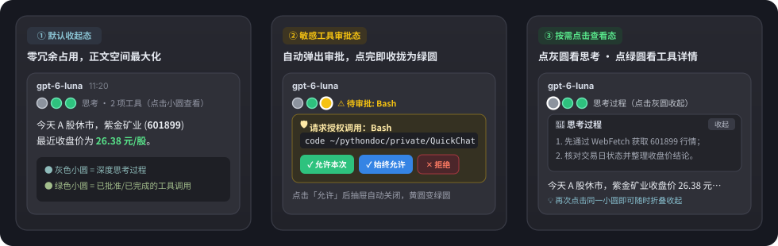
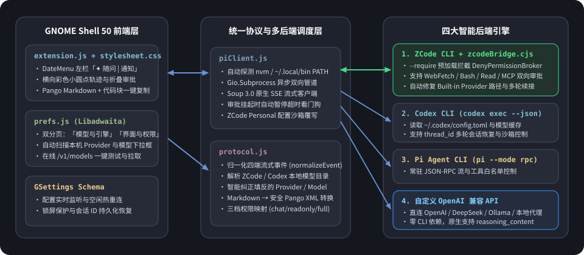
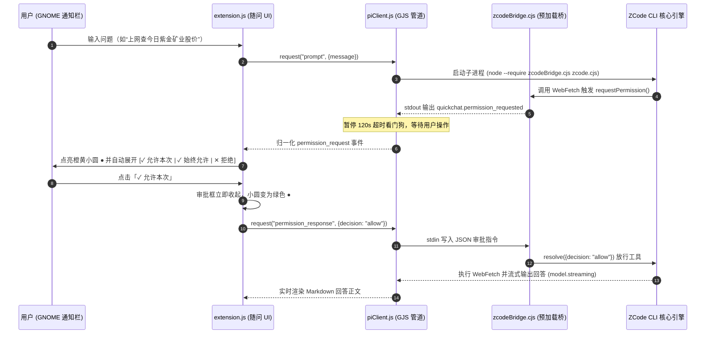

<div align="center">

# ✦ Quick Chat · 随问 (`gnome-quick-chat`)

**专为 Ubuntu 26.04 / GNOME Shell 50 打造的系统通知栏原生 AI 随问与 Agent 工具助手**

[](https://www.gnome.org/)
[](https://ubuntu.com/)
[](#3-四大智能后端与模型自动发现)
[](#7-开发与测试)

点击屏幕顶部中央的「时间 / 日期」，即可在原有通知栏左栏无缝切换 **「✦ 随问 | 通知」**，右侧原生日历与世界时钟保持原样。  
纯原生 `GJS` / `St` / `Clutter` 构建，**零 WebView 内存开销**，支持 **Markdown 代码块渲染**、**横向彩色小圆点工具轨迹**与**敏感工具交互式审批**。

<br/>


</div>

---

## 目录

1. [核心特性一览](#1-核心特性一览)
2. [横向彩色小圆点轨迹与交互式工具审批](#2-横向彩色小圆点轨迹与交互式工具审批)
3. [四大智能后端与模型自动发现](#3-四大智能后端与模型自动发现)
4. [真实桌面运行实拍](#4-真实桌面运行实拍)
5. [系统架构与双向审批时序](#5-系统架构与双向审批时序)
6. [快速安装与配置指南](#6-快速安装与配置指南)
7. [快捷键与交互技巧](#7-快捷键与交互技巧)
8. [开发与测试](#8-开发与测试)

---

## 1. 核心特性一览

* **🎨 原生 GNOME 50 界面与丝滑 Clutter 动效**
  * **双标签无缝融合**：在通知栏左侧提供 `✦ 随问` 与 `通知` 分段胶囊切换，实时汇总系统未读通知角标；主动解除 GNOME 50 `DateMenuLayout` 冻结，确保首次展开、切换标签与流式输出时右侧日历零抖动。
  * **微交互动画**：支持标签切换渐隐位移动画、消息气泡入场回弹、状态指示灯呼吸脉冲、平滑滚动以及底端悬浮圆形「`↓` 回到底部」按钮。
  * **深浅色自适应**：实时监听 `org.gnome.desktop.interface` 主题切换，自动适配 Ubuntu 深色与浅色模式。
* **🟢 横向彩色小圆点轨迹栏 (`Trace Dots`) + 按需折叠抽屉**
  * 将「深度思考」「工具调用」与「权限审批」浓缩为标题下方仅 20px 高的**单行横向彩色小圆点**：
    * **灰色小圆 (`●`)**：代表模型深度思考过程，点击即可展开/收起推理链路；
    * **绿色小圆 (`●`)**：代表已批准或已执行完成的工具调用，每个工具对应一个独立小圆，点击可查看具体请求 URL、命令参数与耗时；
    * **橙黄小圆 (`●`)**：代表待审批的敏感工具调用，自动弹出审批按钮，点击允许后**立即自动收拢为绿色小圆**，不挤占正文空间；
    * **红色小圆 (`●`)**：代表已拒绝或执行报错的工具调用。
* **📝 结构化 Markdown 与独立代码块卡片**
  * 基于安全转义的 Pango Markup + `St.BoxLayout` 渲染标题、粗斜体、行内代码、列表、分割线，以及带语言标识和一键「复制代码（`✓ 已复制`）」按钮的独立代码块。
* **🔌 四大后端引擎 + Provider/模型自动探测**
  * 支持 **ZCode CLI**、**Codex CLI**、**Pi CLI** 以及 **自定义 OpenAI 兼容接口（OpenAI / DeepSeek / Ollama / vLLM / 本地代理）**。
  * Libadwaita 首选项窗口自动扫描本机配置文件中的 Provider 与模型列表生成下拉框，并支持一键请求 `/v1/models` 在线测速与拉取模型。

---

## 2. 横向彩色小圆点轨迹与交互式工具审批

为了在紧凑的通知栏空间内兼顾强大的 Agent 工具能力（联网搜索/抓取、本地文件检索、终端命令执行）与清爽的阅读体验，**随问**设计了三态折叠小圆点交互：

<div align="center">
  
</div>

| 圆点颜色 | 状态含义 | 鼠标悬停 (`Hover`) | 鼠标点击 (`Click`) |
| :---: | :--- | :--- | :--- |
| **⚪ 灰色小圆** | 模型深度思考 (`Thinking`) | 同行提示显示「思考过程（点击展开）」 | 展开/收起完整思考推理文本 |
| **🟢 绿色小圆** | 工具已批准 / 执行完成 | 同行实时预览工具名与请求摘要（如 `WebFetch: https://...`） | 展开/收起该工具的完整参数、状态与耗时 |
| **🟡 橙黄小圆** | 敏感工具等待用户授权 | 显示 `⚠️ 待审批: <工具名>` | 自动展开 `✓ 允许本次` / `✓ 始终允许` / `✕ 拒绝` 按钮；点选后自动收起并转为绿/红圆 |
| **🔴 红色小圆** | 用户已拒绝 / 工具执行报错 | 显示工具名与错误摘要 | 展开查看拒绝记录或详细报错信息 |

---

## 3. 四大智能后端与模型自动发现

在 `gnome-extensions prefs quick-chat@lbg2002.github.io` 设置面板中，采用清晰的双分页 Libadwaita 布局（**「模型与引擎」** + **「界面与权限」**）：

| 后端引擎 | 适用场景 | 本地配置自动扫描路径 | 工具与会话能力 |
| :--- | :--- | :--- | :--- |
| **ZCode CLI** (`zcode`) | 本机安装 ZCode 桌面端或 CLI | `~/.zcode/config/provider/personal.json` | 通过 `zcodeBridge.cjs` 预加载实现无头模式交互式工具审批，支持 `--resume` 多轮会话续接 |
| **Codex CLI** (`codex`) | 本机安装 OpenAI Codex CLI | `~/.codex/config.toml`、`~/.codex/models_cache.json` | 支持 `codex exec resume` 多轮会话及沙箱权限控制 |
| **Pi CLI** (`pi`) | 本机安装 Pi Coding Agent | CLI 默认环境与自定义参数 | 常驻 `pi --mode rpc` 双向 JSON-RPC 流与工具白名单 |
| **自定义 OpenAI API** (`openai`) | 直连 OpenAI / DeepSeek / Ollama / 本地代理 | 支持任意标准 `/v1/chat/completions` 接口 | 基于 `Soup 3.0` 原生 SSE 流式解析（含 `reasoning_content` 思考流），无需安装任何 CLI |

### 三档 Agent 权限模式

1. **纯问答 (`chat`)**：禁用本地工具，适合极速日常问答。
2. **智能审批 Agent (`readonly`，默认推荐)**：完整开放联网抓取 (`WebFetch` / `WebSearch`)、本地文件检索 (`Read` / `Glob` / `Grep`)、终端命令 (`Bash`) 与技能 (`Skill` / `MCP`)；只读操作自动执行，敏感或外部操作通过小圆点抽屉由您交互式审批。
3. **全自动 Agent (`full`)**：免审批自动执行一切工具（对应 ZCode `--mode yolo` / Codex `danger-full-access`），请仅在受控可信任务中开启。

---

## 4. 真实桌面运行实拍

<table>
  <tr>
    <td width="50%" align="center">
      
      <br/>
      <sub><b>图 1：在 Ubuntu 26.04 通知栏中调用 ZCode 联网工具实时查询 A 股行情</b></sub>
    </td>
    <td width="50%" align="center">
      
      <br/>
      <sub><b>图 2：思考过程折叠、Markdown 富文本排版与独立代码块一键复制</b></sub>
    </td>
  </tr>
</table>

---

## 5. 系统架构与双向审批时序

<div align="center">
  
</div>

### ZCode 无头模式交互式权限桥接原理 (`zcodeBridge.cjs`)

ZCode CLI 在 `-p --output-format stream-json` 无头模式下默认使用 `DenyPermissionBroker` 自动拒绝一切需授权的工具。本项目通过 Node `--require` 预加载 [zcodeBridge.cjs](zcodeBridge.cjs)，在进程启动期热替换 `DenyPermissionBroker.prototype.requestPermission`，打通 `stdout` 权限请求事件与 `stdin` 实时审批回执：



---

## 6. 快速安装与配置指南

### 环境要求

* **操作系统与桌面**：Ubuntu 26.04 LTS（或任何搭载 **GNOME Shell 50** 的 Linux 发行版）
* **基础依赖**：`glib-compile-schemas`（Ubuntu 可通过 `sudo apt install libglib2.0-bin` 安装）
* **智能后端（四选一即可）**：`ZCode`、`Codex CLI`、`Pi CLI`，或任意 **OpenAI 兼容 API 地址**

### 一键安装

```bash
git clone https://github.com/lbg2002/gnome-quick-chat.git
cd gnome-quick-chat
bash install.sh
```

> **提示**：
> 1. `install.sh` 会自动编译 GSettings Schema、复制扩展文件至 `~/.local/share/gnome-shell/extensions/quick-chat@lbg2002.github.io` 并写入启用列表。
> 2. 在 **Wayland** 会话下，首次安装或更新 `extension.js` 后，请**注销并重新登录一次桌面**以让 GNOME Shell 进程加载扩展。
> 3. 登录后点击屏幕顶部中间的**日期/时间**，即可在左侧看到 **「✦ 随问 | 通知」**。

### 打开设置窗口

点击随问面板右上角的 **「⚙」** 按钮，或在终端执行：

```bash
gnome-extensions prefs quick-chat@lbg2002.github.io
```

---

## 7. 快捷键与交互技巧

| 操作 / 快捷键 | 功能说明 |
| :--- | :--- |
| **`Enter`** | 发送当前输入框中的问题 |
| **`Shift + Enter`** | 在输入框内换行 |
| **`↑` / `↓` 方向键** | 当输入框为空或正在浏览历史时，快速回溯上/下一条历史提问 |
| **`Esc`** | 当模型正在思考或生成回答时，立即中止当前生成请求 |
| **`Ctrl + N` / `Ctrl + L`** | 在空闲状态下快速开启新对话并清空上下文 |
| **点击彩色小圆点 (`●`)** | 展开/切换查看模型思考过程（灰圆）或某次工具调用详情（绿/黄/红圆），再次点击收起 |
| **向上滚动阅读长文** | 自动锁定视口防止流式输出强制跳底，并在底部中央浮现圆形 `↓` 按钮，点击一键回到底部 |

---

## 8. 开发与测试

项目核心文件结构清晰，所有协议转换、Provider/模型目录解析与 Pango Markdown 转换均解耦在纯函数模块 [protocol.js](protocol.js) 中，便于独立运行单元测试：

```text
.
├── extension.js          # GNOME Shell 50 DateMenu 界面、动画、横向小圆点轨迹与交互逻辑
├── piClient.js           # 多后端进程生命周期、PATH 探测、ZCode 配置沙箱与 Soup 3.0 SSE 客户端
├── protocol.js           # 协议归一化、Provider/模型目录解析、Pango Markdown 与代码块解析器
├── zcodeBridge.cjs       # ZCode CLI 无头模式双向权限审批预加载桥接脚本
├── prefs.js              # Libadwaita 双分页设置中心（支持本地配置扫描与 /v1/models 在线拉取）
├── stylesheet.css        # 深浅色自适应样式、小圆点状态配色与气泡样式
├── metadata.json         # GNOME Shell 扩展元数据
├── schemas/              # GSettings 配置 Schema 定义
├── tests/                # Node.js 自动化单元测试套件
├── docs/assets/          # README 架构图、交互示意图与实拍截图
├── install.sh            # 一键安装并自动注册启用脚本
└── uninstall.sh          # 一键卸载脚本
```

运行单元测试与 Schema 严格校验：

```bash
npm test
glib-compile-schemas --strict schemas/
```

查看运行日志：

```bash
journalctl --user -b -f | grep -Ei 'Quick Chat|quick-chat|gnome-shell'
```

卸载扩展：

```bash
bash uninstall.sh
```
